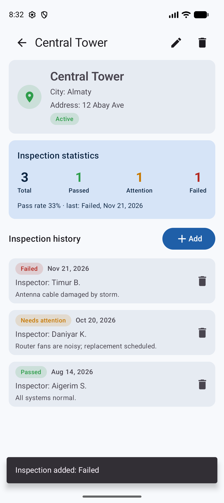
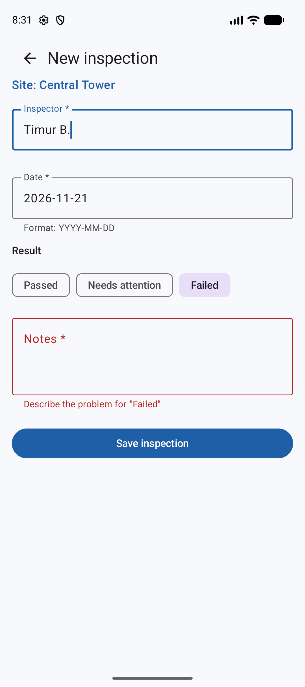
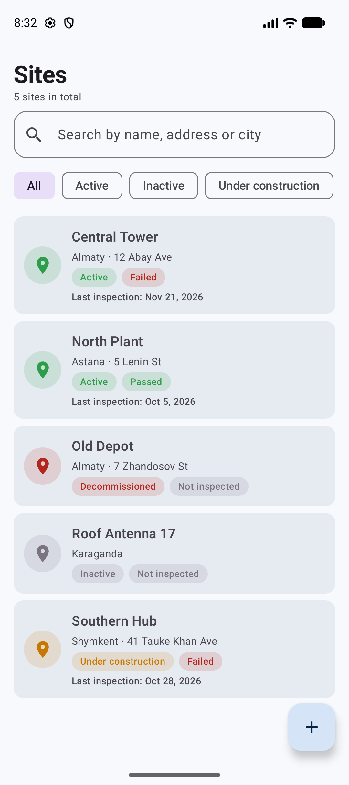

# Site Tracker — Android (Kotlin + Jetpack Compose + Room)

Mobile version of the **Site-Tracker** web project: an app for tracking telecom sites (name, address, city, status)
and their **inspection history**. All data is stored locally with Room and survives app restarts.

> Mobile Programming — Task 3: MVVM and local data storage.

## Screenshots of the additional feature (inspection history & statistics)

| 1. Inspection history and statistics | 2. Adding an inspection (with validation) | 3. Latest result shown in the sites list |
|---|---|---|
| A new *Failed* inspection was saved: statistics are recalculated and a snackbar confirms the action | Notes are required for *Failed* / *Needs attention*, so saving without them shows an error | The list updates by itself: Central Tower now shows *Failed · Nov 21, 2026* |
|  |  |  |

## Features

- **Sites list** — `LazyColumn` with stable keys (site id), search by name / address / city, filter by status.
- **Site details** — city, address, status, inspection statistics and inspection history.
- **Create / edit site** — one form for both modes, with validation.
- **Delete site** — with a confirmation dialog (its inspections are deleted together with it).
- **Additional feature: inspection history with statistics** (see below).

### Additional feature: inspection history with statistics

Every site has its own history of inspections (one-to-many relationship, `inspections.siteId → sites.id`).

1. **Add an inspection** from the site details screen: inspector, date, result
   (*Passed / Needs attention / Failed*) and notes. Notes are **required** when the result is not *Passed*.
2. **History** — all inspections of the site, newest first; each can be **deleted with confirmation**.
3. **Statistics** — total, passed, needs attention, failed, pass rate and the latest result with its date.
   They are recalculated automatically after every add or delete.
4. **Shown on other screens** — the sites list shows each site's latest inspection result and date
   ("Not inspected" if it has none). Adding or deleting an inspection updates the list without any refresh.
5. **Persistent** — inspections are stored in their own Room table and remain after restarting the app.

## Navigation (Navigation Compose)

| Screen | Route | Opened from |
|---|---|---|
| Sites (list) | `sites` (start) | — |
| Site details | `site/{siteId}` | tap a site |
| New / edit site | `site_form?siteId={siteId}` | "+" button (new) or ✏️ on the details screen (edit) |
| New inspection | `inspection_form/{siteId}` | "Add" on the details screen |

## Architecture (MVVM)

```
ui/screens      Compose screens          *Route (ViewModel + collectAsStateWithLifecycle) → *Screen (stateless)
ui/components   reusable composables     SiteCard, InspectionItem, InspectionSummaryCard, ConfirmDeleteDialog, ...
ui/viewmodel    ViewModels               SitesViewModel, SiteDetailViewModel, SiteFormViewModel, InspectionFormViewModel
data            repositories + models    SiteRepository, InspectionRepository, Site, Inspection, InspectionSummary
data/local      Room data source         SiteEntity, InspectionEntity, SiteDao, InspectionDao, AppDatabase
```

```
Room (SQLite) ──Flow──▶ Repository ──Flow──▶ ViewModel ──StateFlow<UiState>──▶ Compose screen
                             ▲                    ▲                                   │
                             └──── suspend ───────┴─────── ViewModel methods ◀── user actions
```

- Every ViewModel exposes one immutable UI state through **`StateFlow`** (`stateIn` on top of Room `Flow`s).
- Screens collect it with **`collectAsStateWithLifecycle()`**.
- **State hoisting:** `*Screen` composables are stateless — they receive state and callbacks.
- Composables never change data directly. Every action goes through a ViewModel method
  (`save()`, `deleteSite()`, `deleteInspection()`, …), which calls a repository.
- ViewModels get repositories through a factory (`AppViewModelProvider`), and the database is created once in
  `SiteTrackerApplication`.
- One-time events (saved, deleted) go through a `Channel`, so the snackbar and navigation happen exactly once.

## Room and CRUD

| Operation | Site | Inspection |
|---|---|---|
| Create | `SiteDao.insert` ← "Create site" | `InspectionDao.insert` ← "Save inspection" |
| Read | `observeAll()`, `observeById()` → `Flow` | `observeAll()`, `observeForSite()` → `Flow` |
| Update | `SiteDao.update` ← "Save changes" | — |
| Delete | `SiteDao.deleteById` ← confirmation dialog | `InspectionDao.deleteById` ← confirmation dialog |

The DAO queries return `Flow`, so Room re-emits whenever a table changes and every screen that shows the data
updates by itself. For example, editing a site updates both the details screen and the list.
On the very first launch the database is filled with the same sample data as the web version (one-time seed).

## Input validation

| Field | Rules |
|---|---|
| Site name | required, 3–50 characters |
| Address | optional, max 100 characters |
| City, status, result | chosen from fixed options |
| Inspector | required, 2–50 characters |
| Date | required, `YYYY-MM-DD`, must be a real date, not in the future |
| Notes | max 200 characters; required if the result is *Needs attention* or *Failed* |

Errors are shown under the fields; an empty form shows them only after pressing Save.

## Empty states and feedback

- No sites: "No sites yet. Tap + to add the first one." Nothing found: "No sites match your search or filter".
- Site without inspections: "No inspections yet…", statistics show "Never inspected".
- A snackbar confirms every action: site added / updated / deleted, inspection added / deleted.

## Rotation and restart

The Activity is recreated on rotation (no `configChanges` override). Data lives in Room. Search, filter and
form fields live in ViewModels. Open dialogs use `rememberSaveable`, and the back stack is kept by
`rememberNavController`. Nothing is lost on rotation, and all sites and inspections remain after restarting the app.

## Run

Android Studio (Ladybug or newer), JDK 17+, emulator or device with API 26+.
Open the project folder, wait for Gradle sync, press **Run ▶**.
To reset to the sample data, uninstall the app or clear its storage.

## Tech stack

Kotlin 2.0, Jetpack Compose (BOM 2024.10), Material 3, Navigation Compose 2.8, Lifecycle ViewModel 2.8,
Room 2.6 (KSP), Kotlin coroutines / Flow.
